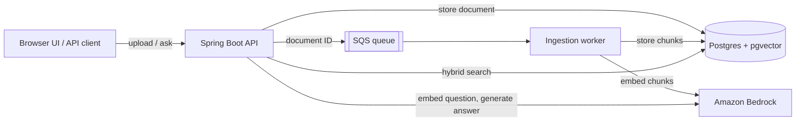

# Multi-Tenant RAG Platform

A retrieval-augmented generation (RAG) service. You upload text documents,
ask questions about them, and get answers grounded in those documents with
numbered citations. Each tenant's data is isolated inside the database by
PostgreSQL row-level security.

**Stack:** Java 21, Spring Boot 4, PostgreSQL 16 + pgvector, Amazon Bedrock
(Titan Text Embeddings V2 for embeddings, Claude Haiku 4.5 for answers),
Amazon SQS, Terraform on ECS Fargate.

## Features

- **Hybrid retrieval.** Semantic search with pgvector (HNSW, cosine distance)
  and Postgres full-text search, merged with Reciprocal Rank Fusion.
- **Cited answers.** Answers cite their sources inline, like `[1]`, and come
  back as one JSON response or as a token stream over Server-Sent Events.
- **Asynchronous ingestion.** Uploads return right away. A worker chunks and
  embeds documents from an SQS queue, with status tracking, retries, and a
  dead-letter queue.
- **Database-enforced tenant isolation.** Row-level security policies on a
  non-owner role keep tenants apart even if a query leaves out its tenant
  filter.
- **Deduplication.** Re-uploading the same file is a no-op, and chunk inserts
  are idempotent, so retried ingestion jobs never create duplicate chunks.
- **Evaluation harness.** Measures retrieval hit rate, answer quality (scored
  by an LLM judge), and latency against a fixed question set.
- **Low-cost AWS deployment.** Terraform deploys to Fargate Spot behind HTTPS
  for about $22/month.

## How it works



**Ingestion.** `POST /documents` reads the file as UTF-8 text and hashes it.
If this tenant has already uploaded the same content, it returns
`ALREADY_INGESTED`. Otherwise it stores the document as `PENDING` and queues
its ID on SQS. The worker, a scheduled poller in the same process, splits the
text into 1,000-character chunks and embeds each one as a normalized
1024-dimension vector. It moves the document through `PROCESSING` to `READY`,
or to `FAILED` on error. A failed message stays on the queue and is retried
after the visibility timeout. After three failed deliveries, it moves to the
dead-letter queue.

**Retrieval.** The question is embedded and run through two searches over the
tenant's chunks: vector search on an HNSW index, and a `plainto_tsquery` match
against a generated `tsvector` column with a GIN index. The top 20 results
from each search are merged with Reciprocal Rank Fusion (k = 60), and the
best 5 chunks go to the model.

**Generation.** The prompt numbers the five chunks as sources. It tells Claude
to answer only from those sources, cite them inline, and say it doesn't know
when the sources don't contain the answer. The streaming endpoint sends the
citations first, so the client can resolve `[1]` as soon as it appears in the
text.

**Tenant isolation.** Every request to `/documents` or `/query` must carry an
`X-Tenant-Id` UUID header. The service uses two database roles:

| Role | Used by | Can see | Allowed writes |
| --- | --- | --- | --- |
| `rag_app` | API requests | Rows whose `tenant_id` matches `app.current_tenant_id` | Insert documents |
| `rag_worker` | Ingestion worker | All tenants' rows | Update document status, insert chunks |

Each repository call sets `app.current_tenant_id` with
`set_config(..., true)`. The setting is local to the transaction, so it can't
carry over to the next request that borrows the same pooled connection.
Row-level security is forced on both tables. The worker gets a permissive
policy instead of `BYPASSRLS`, which keeps the role least-privileged and works
on Amazon RDS.

## API

| Method | Path | Request | Response |
| --- | --- | --- | --- |
| `POST` | `/documents` | Multipart form, field `file` | `{documentId, status}`: `PENDING` or `ALREADY_INGESTED` |
| `GET` | `/documents/{id}` | | `{documentId, status}`: `PENDING`, `PROCESSING`, `READY`, or `FAILED` |
| `POST` | `/query` | `{"question": "..."}` | `{answer, citations: [{id, documentId, content, score}]}` |
| `GET` | `/query/stream?question=...` | | Server-Sent Events: one `citations` event, then `delta` events of `{"text": "..."}` |

All four endpoints require the `X-Tenant-Id` header.

```bash
TENANT=11111111-1111-1111-1111-111111111111

curl -H "X-Tenant-Id: $TENANT" -F file=@notes.txt http://localhost:8080/documents

curl -H "X-Tenant-Id: $TENANT" -H "Content-Type: application/json" \
  -d '{"question": "What does the document say about X?"}' \
  http://localhost:8080/query
```

The service also serves a single-page UI at `/`. In it you can pick or
generate a tenant ID, upload files, watch their ingestion status, and ask
questions with streamed answers.

## Running locally

You need Java 21, Docker, and AWS credentials that the default credential
chain can find. The AWS account needs Bedrock access to Titan Text Embeddings
V2 and Claude Haiku 4.5 in `us-east-1`, plus an SQS queue.

1. **Start Postgres with pgvector.** It listens on `localhost:5433`, with
   superuser `rag` and password `ragpass`.

   ```bash
   docker compose up -d
   ```

2. **Apply the schema.** This creates the extension, both roles, the tables,
   the indexes, and the row-level security policies. The passwords below match
   the defaults in `application.yml`. The script is idempotent, so you can run
   it again safely.

   ```bash
   docker compose cp infra/sql/001_initial_schema.sql postgres:/tmp/schema.sql
   docker compose exec postgres psql -U rag -d ragdb \
     -v app_db_password=app_pw -v worker_db_password=worker_pw -f /tmp/schema.sql
   ```

3. **Point the app at your queue.** `application.yml` contains the author's
   queue URL. Create your own queue and override the setting:

   ```bash
   aws sqs create-queue --queue-name rag-ingestion-queue
   export AWS_SQS_INGESTION_QUEUE_URL=https://sqs.us-east-1.amazonaws.com/<account-id>/rag-ingestion-queue
   ```

   In PowerShell, use `$env:AWS_SQS_INGESTION_QUEUE_URL = "..."`.

4. **Run the app.** On Windows, use `mvnw.cmd`.

   ```bash
   ./mvnw spring-boot:run
   ```

   Then open http://localhost:8080.

### Configuration

Every setting can be overridden with an environment variable:

| Property | Environment variable | Default |
| --- | --- | --- |
| `app.datasource.jdbc-url`, `.username`, `.password` | `APP_DATASOURCE_JDBC_URL`, `_USERNAME`, `_PASSWORD` | `localhost:5433/ragdb`, `rag_app` / `app_pw` |
| `worker.datasource.jdbc-url`, `.username`, `.password` | `WORKER_DATASOURCE_JDBC_URL`, `_USERNAME`, `_PASSWORD` | `localhost:5433/ragdb`, `rag_worker` / `worker_pw` |
| `aws.region` | `AWS_REGION` | `us-east-1` |
| `aws.bedrock.embedding-model-id` | `AWS_BEDROCK_EMBEDDING_MODEL_ID` | `amazon.titan-embed-text-v2:0` |
| `aws.bedrock.chat-model-id` | `AWS_BEDROCK_CHAT_MODEL_ID` | `us.anthropic.claude-haiku-4-5-20251001-v1:0` |
| `aws.sqs.ingestion-queue-url` | `AWS_SQS_INGESTION_QUEUE_URL` | The author's queue |

The app datasource must log in as `rag_app`, never as the table owner or a
superuser. Postgres skips row-level security for superusers, which would turn
off tenant isolation.

## Deploying to AWS

[terraform/README.md](terraform/README.md) has the full deployment steps. In
short, Terraform creates one Fargate Spot task that runs four containers:

- a migration container that applies the schema SQL, then exits
- the Spring Boot app, which runs both the API and the ingestion worker
- a DuckDNS updater that points a stable hostname at the task's public IP
- a Caddy proxy that serves HTTPS with a Let's Encrypt certificate

Around the task, it creates RDS PostgreSQL 16 in a private subnet, an SQS
queue with a dead-letter queue, database credentials in Secrets Manager, and
CloudWatch logs. There is no NAT gateway or load balancer, which keeps the
cost to about $22/month. That README also lists what to change before using
the stack beyond a demo.

## Evaluation

The `eval` package contains two command-line tools. `EvalRunner` runs the
cases in
[src/main/resources/eval/dataset.json](src/main/resources/eval/dataset.json)
against a running API. `CompareRuns` diffs two saved runs. The dataset has
15 cases:

- **12 in-scope questions.** Each case lists a substring that one of the
  retrieved chunks should contain, and the facts a correct answer must cover.
- **3 out-of-scope questions.** For these, the correct answer is "I don't
  know."

The runner records three things for each case:

| Metric | How it is measured |
| --- | --- |
| Retrieval hit | Whether any of the five cited chunks contains the expected substring. Out-of-scope cases always count as hits. |
| Judge score | Claude Haiku 4.5 grades the answer from 1 to 5 against the expected facts. For out-of-scope cases, declining scores 5 and a hallucinated answer scores 1. An unparseable judge reply scores 0 so you can spot it. |
| Latency | End-to-end time of `POST /query` |

The questions were written for a document that describes several software
projects, and that document is not in this repository. To use the harness,
upload your own document under the eval tenant and rewrite `dataset.json` to
match it.

```bash
# Run the dataset and write eval-results/my-run.csv
./mvnw compile exec:java "-Dexec.mainClass=com.example.rag.eval.EvalRunner" "-Dexec.args=my-run"

# Compare the run against the baseline
./mvnw exec:java "-Dexec.mainClass=com.example.rag.eval.CompareRuns" "-Dexec.args=prod-baseline.csv my-run.csv"
```

The runner reads these environment variables:

- `API_BASE_URL` (default `http://localhost:8080`)
- `EVAL_TENANT_ID` (default `11111111-1111-1111-1111-111111111111`)
- `JUDGE_MODEL_ID`
- `AWS_REGION`

Results from the current baseline,
[eval-results/prod-baseline.csv](eval-results/prod-baseline.csv):

| Metric | Result |
| --- | --- |
| Retrieval hit rate | 73.3% (11 of 15). On the 12 in-scope questions alone, 8 of 12. |
| Average judge score | 4.73 / 5 |
| Average latency | 1,720 ms |

## Known limitations

- **No authentication.** The service trusts the `X-Tenant-Id` header as sent.
  It stands in for the tenant an auth layer would supply, so the service
  isolates tenants from each other but doesn't control who can act as which
  tenant.
- **Plain text only.** Uploads are read as UTF-8 text. There is no PDF or
  DOCX parsing.
- **Simple chunking.** Chunks are fixed 1,000-character windows with no
  overlap, so a sentence can be split across two chunks.
- **Sequential embedding.** The worker embeds a document's chunks one at a
  time, so ingesting a long document takes a while.

## Project layout

```text
src/main/java/com/example/rag/
  chat/        Bedrock Converse calls for blocking and streaming answers
  config/      The two data sources (rag_app and rag_worker)
  embedding/   Titan embeddings
  eval/        Evaluation runner and run comparison
  ingestion/   Upload API, SQS publisher, worker, chunking
  query/       Query API and hybrid search
  storage/     JDBC repositories, one per database role
  tenant/      X-Tenant-Id filter and per-request tenant context
src/main/resources/static/  Single-page UI
src/main/resources/eval/    Evaluation dataset
infra/                      Schema SQL and the migration entrypoint
terraform/                  AWS deployment
eval-results/               Saved evaluation runs
```
